# Fiche événement : vérification visuelle du 16 novembre 2026

Captures de l'application réelle, avec données de démonstration, prises après les migrations et le seed existant. Aucune donnée de production ni preview externe.

## Parcours vérifiés dans l'interface

- Édition du titre puis enregistrement.
- Création et liaison d'une mission, création d'une tâche.
- Création et liaison d'un groupe, liaison d'un groupe existant.
- Ajout d'un lien documentaire et affichage de l'erreur quand les champs sont vides.
- Aperçu du recalcul horaire, application, puis réduction de durée.
- Refus explicite d'un recalcul bloqué par un créneau figé.
- Figer/Défiger et duplication vers une nouvelle fiche.
- Historique réellement alimenté par ces actions.
- Lecture seule avec un compte animateur : pas d'actions d'édition.
- Affichage à 390 px : pas de débordement horizontal ; onglets défilants, formulaires et tâches lisibles.

L'ajout de document est un ajout de lien, pas un upload. Le lien example.com est fictif : les captures prouvent la saisie et la persistance, pas la disponibilité d'un fichier distant.

Les horaires réutilisent les règles du planning : une réduction ne restaure pas nécessairement à l'identique les durées des séquences suivantes. Le début d'une tête de chaîne reste non décalable dans ce modèle.

## Tests

- API : 55 fichiers, 422 tests réussis.
- Web : 31 fichiers, 180 tests réussis.
- Builds API et Web development réussis.

## Captures

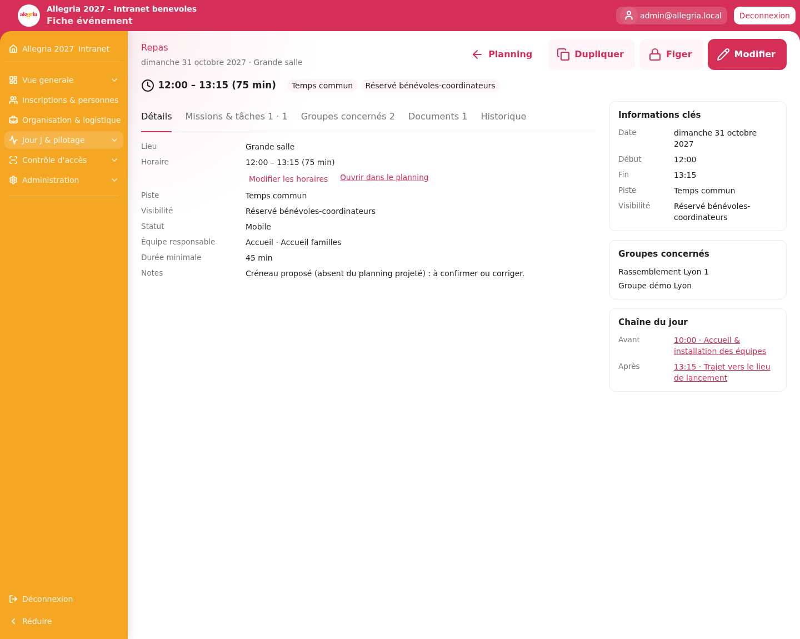
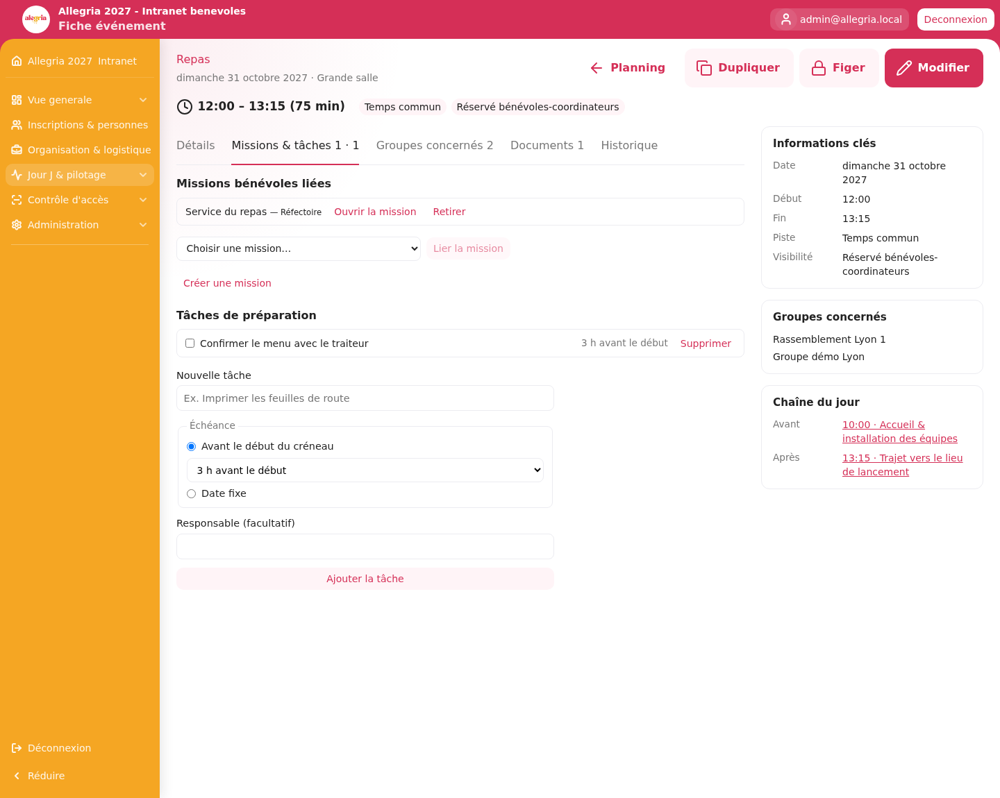
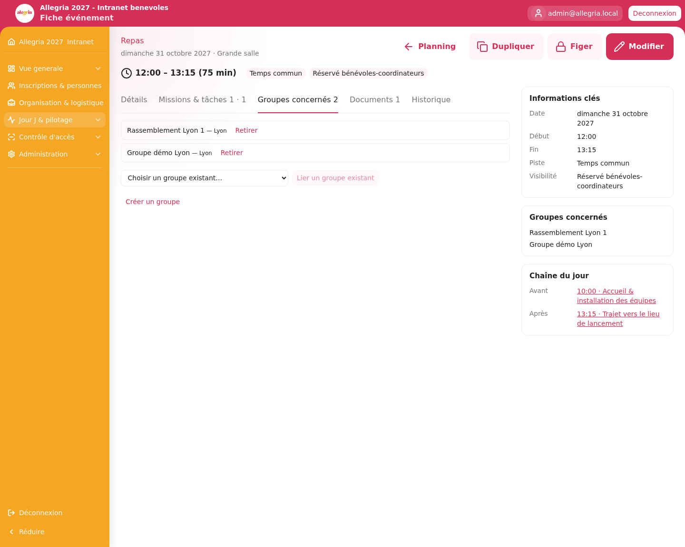
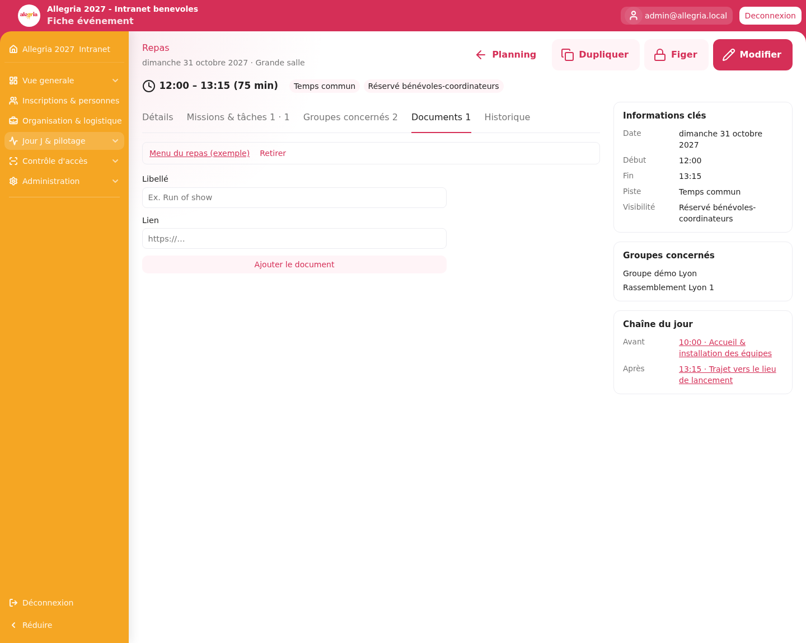
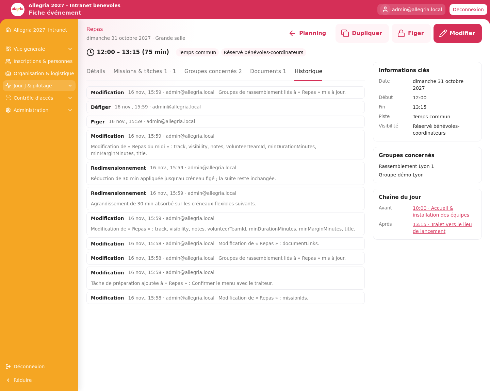
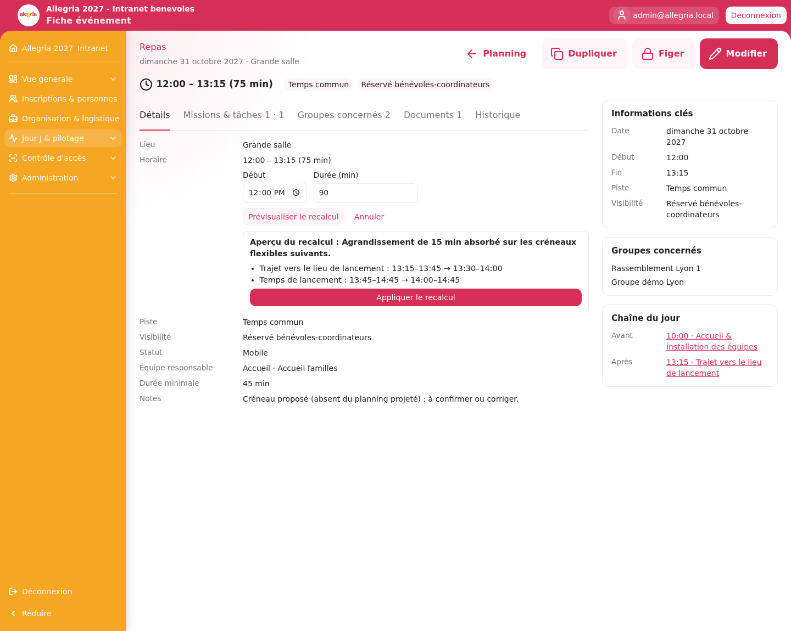
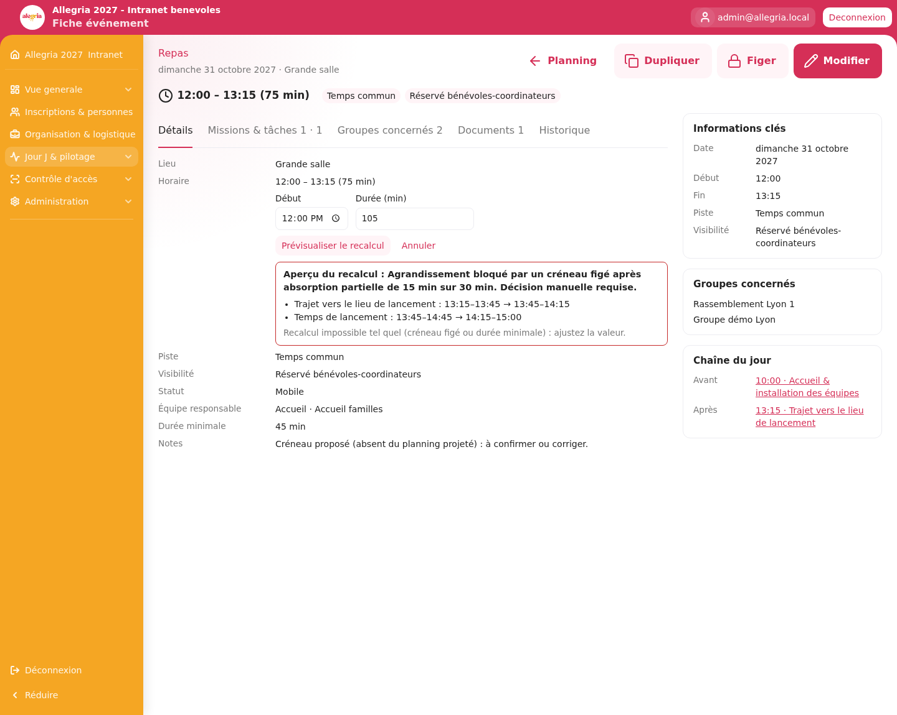
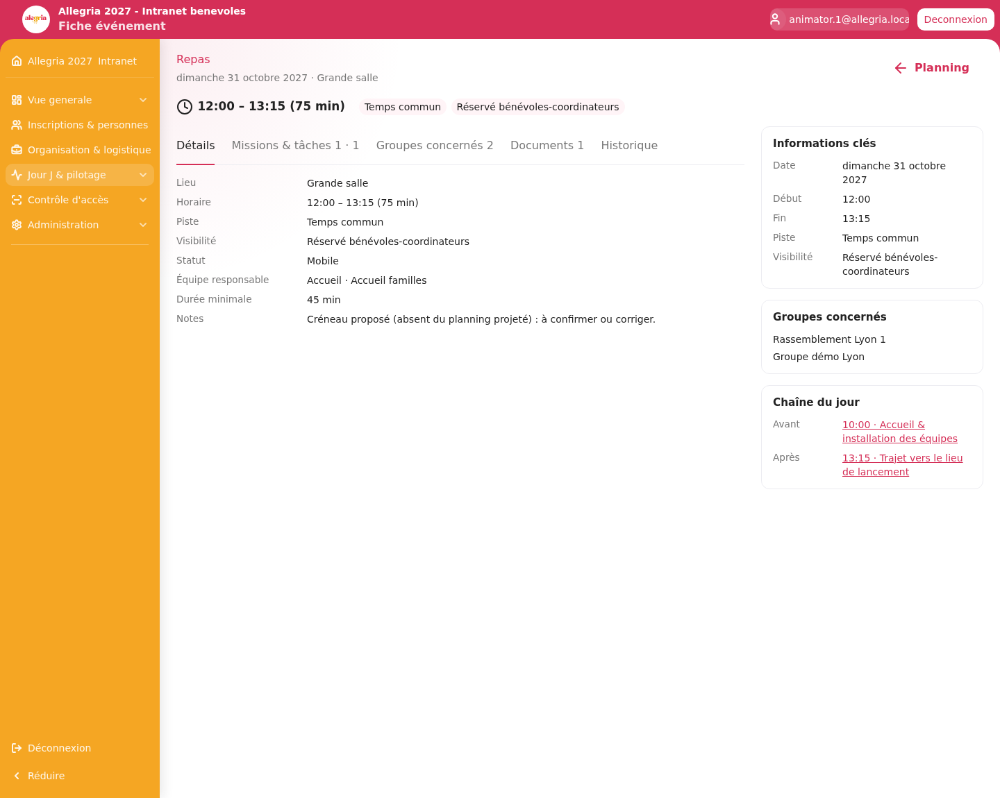
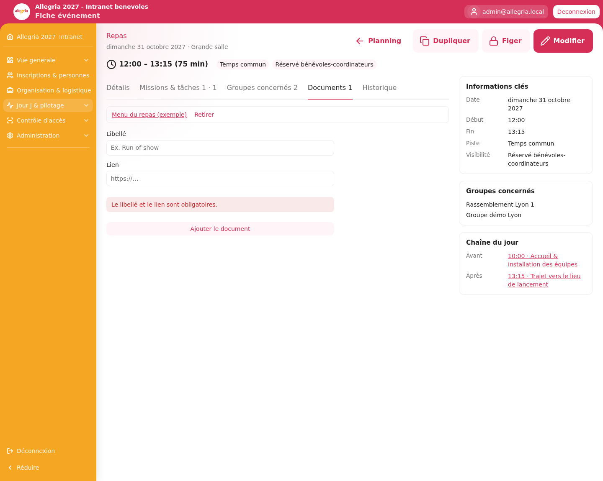
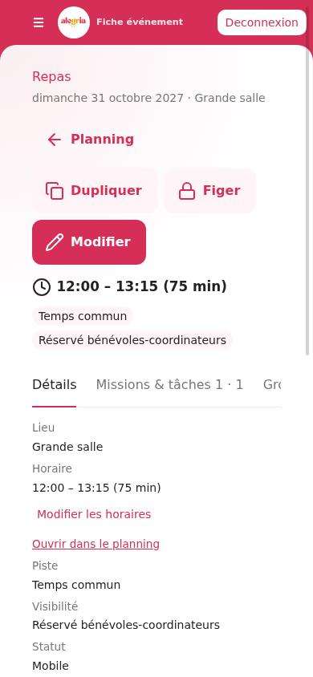
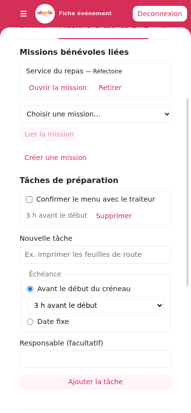
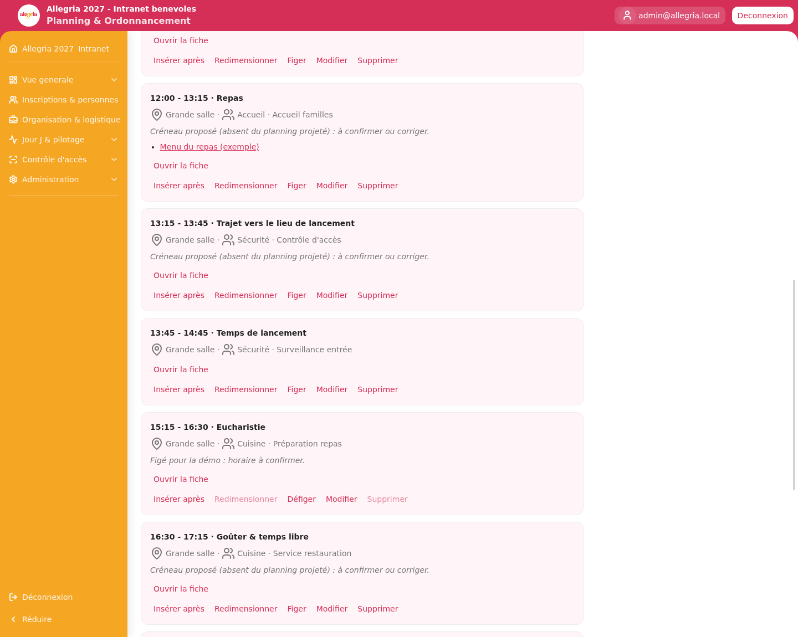
